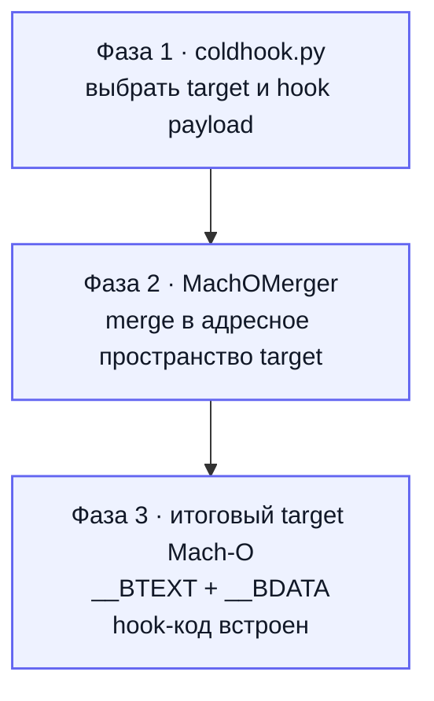
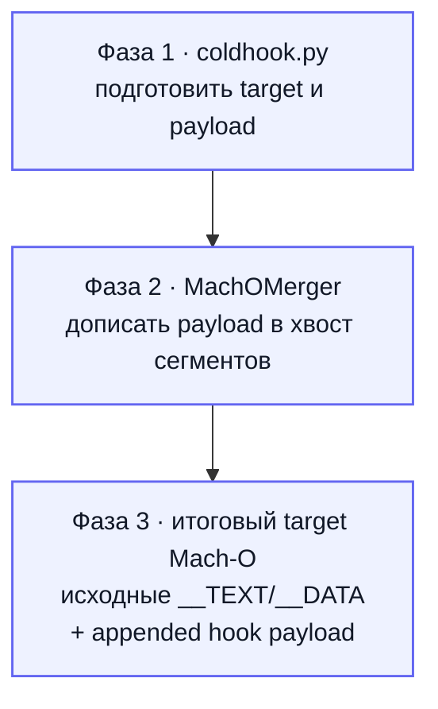
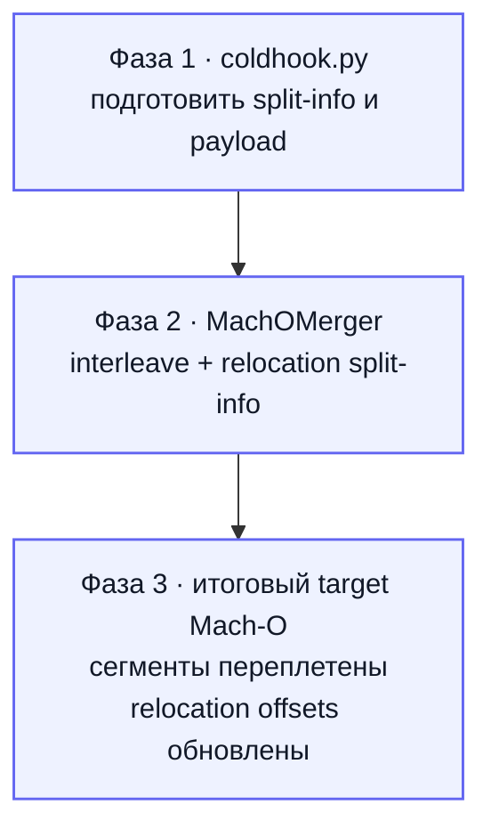
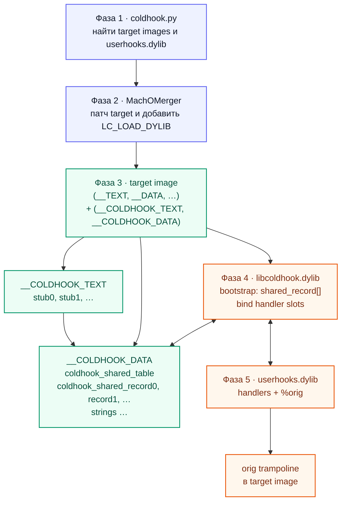

# ColdHook architecture

Этот документ описывает внутреннее устройство ColdHook. Пользовательские команды и примеры находятся в корневом [README.md](../README.md).

## Режимы

`embedded` merge встраивает hook-код непосредственно в target Mach-O. `append` сохраняет существующие сегменты target и добавляет payload в хвост бинаря. `shared` оставляет hook-код в отдельной dylib, а в каждый подходящий target добавляет локальные стабы и metadata.

Shared использует тот же append-style layout, encoder ARM64 branch и relocation-путь, что и append. Отличие — таблица shared-записей, стабы dispatch и `LC_LOAD_DYLIB` для hook/runtime.

## Граф режимов и фаз пайплайна

Каждый режим показан отдельно, поэтому названия фаз и итоговые секции не сжимаются в одну
широкую схему. Общая последовательность начинается в `coldhook.py`; `libcoldhook.dylib`
и `userhooks.dylib` участвуют только в runtime-цепочке shared.

### Embedded



### Append



### Interleave



### Shared



В shared-схеме `__COLDHOOK_TEXT → __COLDHOOK_DATA` — это dispatch через слот. Bootstrap
проходит `shared_record[]`, читает metadata, разрешает handler-ы из `userhooks.dylib`,
заполняет slots и связывает `%orig` с trampoline, оставленным в target, поэтому раздельные
ASLR-слайды не конфликтуют.

## Shared table

В target создаются два сегмента:

- `__COLDHOOK_TEXT,__coldhook_stub` — короткие локальные ARM64 стабы;
- `__COLDHOOK_DATA,__coldhook` — writable table, slots и строки metadata.

ABI таблицы зафиксирован в `coldhook/include/coldhook_shared.h`:

```c
struct coldhook_shared_table {
    uint32_t magic;
    uint16_t version;
    uint16_t header_size;
    uint16_t record_size;
    uint16_t flags;
    uint32_t count;
    uint32_t records_offset;
    uint32_t strings_offset;
    uint32_t strings_size;
};

struct coldhook_shared_record {
    uint64_t hook_id;
    uint32_t handler_slot_offset;
    uint32_t reserved0;
    uint64_t orig_image_offset;
    uint32_t handler_name_offset;
    uint32_t handler_name_size;
    uint32_t orig_slot_key;
    uint32_t flags;
};
```

Полные имена `_COLDHOOK_DYN_*` кодируют selector, locator и handler. MachOMerger
выбирает записи по binary selector, синтезирует stub/table и сохраняет полное
runtime-entry имя как data. Bootstrap перечисляет dyld images, находит provider и
разрешает в scope одной dylib entry вместе с соответствующим `_COLDHOOK_ORIG_*`
slot. Короткие handler names и orig/gate/dispatch helpers наружу не экспортируются.

## Runtime flow

`libcoldhook.dylib` в constructor перечисляет уже загруженные dyld images и подписывается на новые. Для каждого образа он ищет `__COLDHOOK_DATA,__coldhook`, проверяет magic/version, разрешает handler через `dlsym`, атомарно заполняет slot и записывает адрес orig-трамплина.

Вызов выглядит так:

```text
target function
    -> local stub in target
    -> handler slot
    -> handler in shared hook dylib
    -> orig slot
    -> target orig trampoline
```

Orig-трамплин остаётся в target, потому что target и shared dylib имеют независимые ASLR slides. Это позволяет переиспользовать существующий механизм переэнкодирования PC-relative пролога.

## Почему table, а не native bind

Native bind потребовал бы для каждого hook синтезировать импорт, GOT/chained-fixup запись, symbol metadata и корректный dylib ordinal. Это сильнее связывает shared backend с конкретным форматом dyld metadata и увеличивает требования к header space.

Table добавляет фиксированный ABI, локальный stub и data-секцию. Один bootstrap обслуживает любое количество хуков и несколько target images, а диагностика возможна по magic/version/count. Цена — `dlsym` при загрузке.

## Load commands и header space

Shared обычно добавляет два `LC_SEGMENT_64` и один-два `LC_LOAD_DYLIB`. Таблица и стабы сами по себе не создают отдельных load commands. Новый layout переносит `__LINKEDIT` и релокирует dyld info, symtab/dysymtab и остальные file offsets.

Если в header нет свободного места, merge невозможен без отдельной стратегии расширения заголовка. Production-бинари часто имеют несколько килобайт padding между load commands и первым содержимым `__TEXT`; это проверяется до merge.

## IPA/app pipeline

`coldhook shared` распаковывает `.ipa`, находит main executable и embedded frameworks, отбрасывает XCTest/dSYM-служебные Mach-O, применяет shared merge к подходящим images, копирует hook/runtime в `Frameworks` и упаковывает результат. Подпись по умолчанию оставляется пользователю.

Для simulator UI-теста runner дополнительно очищает DYLD-переменные из `.xctestrun`, чтобы XCTest не перенаправлял framework в `Build/Products`, и подписывает вложенные framework/dylib до подписи app.

## Исходники

- `coldhook/ipa.py` — bundle/IPA orchestration;
- `coldhook/shared_runtime.c` — universal bootstrap;
- `vendor/MachOMerger/Sources/MachOMerger/Shared*.swift` — shared extraction, assembly и sections;
- `coldhook/include/coldhook_shared.h` — runtime ABI;
- `tests/simulator/run_shared.py` — end-to-end simulator harness.

Дополнительные design notes: [shared-mode.md](shared-mode.md), [export-structure.md](export-structure.md), [sig-prescan.md](sig-prescan.md).
